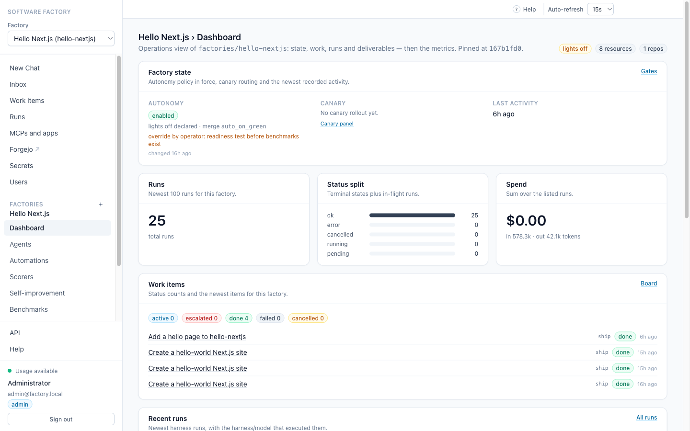

# Software Factory

**The open-source software factory**: a team of AI agents runs the SDLC loop behind a web console —
triage → spec → implement → review → verify → ship — with human gates optional, model- and harness-agnostic.

[Documentation](docs/HANDOVER.md) | [Architecture](docs/ARCHITECTURE.md) | [API](docs/HANDOVER.md) | [Contributing](CONTRIBUTING.md) | [Security](SECURITY.md)

[](https://github.com/kutovoy/ai-software-factory/actions/workflows/ci.yml)




## Introduction

Most "AI coding agent" setups are a chat box with a terminal behind it. A factory is different: work arrives as
an item, a durable workflow drives it through stages, gates decide whether to continue, and the result lands as a
pull request in a forge you own.

This project is that factory, built to be **self-hosted, inspectable and yours**:

- **Definitions as code.** Agents, gates, scorers, benchmarks and automations live in git (`factories/<name>/`),
  versioned and diffable. The console reads them; it never writes your worktree.
- **Lights on or lights off.** Gates resolve `automation → factory → global`, each `human`, `agent` or
  `policy:<name>`. Full autonomy is possible, but enabling it requires a passing benchmark attestation — or an
  explicit, audited override.
- **Model- and harness-agnostic.** Any OpenAI-compatible endpoint (LiteLLM, OpenAI, local), any harness behind one
  adapter contract (opencode today). Provider credentials never enter the sandbox.
- **It measures and improves itself.** Scorers, judge calibration, benchmarks at pinned commits, then a
  propose → probe → compose loop with three authority levels: PR-only, auto-merge on a benchmark win, or canary.

## Features

### Definitions as code
Factories are directories, not database rows: `factory.yaml` plus `agents/`, `scorers/`, `benchmarks/`,
`runners/`, `routing.yaml`. Path is identity; the CLI exports canonical YAML, diffs semantically and pins a commit
per run. `factory validate | export | import | diff | fmt | version`.

### Gates and autonomy
Six policy stages (`spec`, `plan`, `implement`, `review`, `pr_review`, `deploy`) resolve per automation, per factory
and globally. Human gates are durable workflow waits (no worker slot held). A kill switch pauses autonomy; a
benchmark attestation binds commit + configuration hash before lights-off can be enabled.

### Harness and model agnosticism
One canonical `FactoryEvent` stream, one `HarnessAdapter` contract. opencode is the first native adapter; a generic
CLI adapter follows. The model is a resolved reference (`model: env:FACTORY_MODEL`), so the same definition runs
against any endpoint.

### Runners and the inference boundary
Harness execution happens in a sandbox leased by the worker (Docker; local process with an optional macOS
`sandbox-exec` jail). The sandbox gets a per-run proxy token, never the provider key; the API revokes it at run end.
Workspace modes support containerised workers.

### Measurement
Deterministic scorers and LLM judges, sampling and budgets, rubric hashes, full provenance, and calibration against
a golden set. Metrics are derived queries (throughput, cost per PR and per stage, cycle time, autonomy), with
`null` + reason rather than fabricated numbers.

### Benchmarks
Suites pin tasks at commit SHAs and a definition version; `configHash = sha256(matrix + definitionCommit)`. Trials
run hermetically, results aggregate into a Pareto frontier, and a passing, calibrated, non-partial attestation is
what unlocks autonomy.

### Self-improvement
Observer agents read scored runs, propose file-scoped edits (agents, skills, routing, scorers, automations only),
probe them contrastively on the same work, compose the winners and land the candidate according to the factory's
authority: **propose-only PR**, **auto-merge on benchmark win**, or **canary** with deterministic hash routing and
automatic rollback. Lessons live per factory, with opt-in promotion.

### Local forge
The stack ships **Forgejo** at `/extras/forgejo` so PR links resolve. The console proxy asserts the signed-in
user (admin fallback when auth is off), and each user gets a personal organization `u-<username>`; external
OIDC group→org mappings are reserved for Phase 6c. Git also works over SSH on `localhost:2222` (host keys persist
in the `forgejo-data` volume), and an optional Caddy mode serves the forge on `:3001` with websocket upgrades.

### Console
One event renderer for chat and factory runs, runs and work items with live SSE, an inbox for gates and
permissions, factory dashboards (state, work, deliverables), scorers and benchmarks, a live Swagger UI at
`/help/api`, and an in-product help centre.

## Architecture

```
work item ──► FactoryWorkflow (Temporal, one per item)
                 │  deterministic foreman dispatch
                 ├─► StageWorkflow: run → gate → transition
                 │      run = harness in a runner sandbox
                 │      gate = human | agent | policy (durable wait)
                 ├─► review committee (≥2 independent reviewers + judge, advisory)
                 └─► ship: PR ─► merge queue ─► forge
scores ──► calibration ──► benchmarks ──► attestation ──► autonomy
scored corpus ──► improvement: propose → probe → compose ──► PR | merge | canary
```

Postgres is the read model; the append-only JSONL event log is the audit trail and can rebuild it. The console
talks only to the API (ADR-012); the browser never reaches a harness or the database directly.

## Getting started

Prerequisites: Docker (with Compose), Git. Bun 1.4+ only if you run things outside containers.

```bash
git clone <this-repo> && cd SoftwareFactory
cp .env.example .env
```

Set the inference endpoint and model in `.env`:

```dotenv
OPENAI_BASE_URL=http://your-litellm:4000/v1
OPENAI_API_KEY=sk-...            # stays in api/worker; never enters a sandbox
FACTORY_MODEL=your-model-name    # resolved from env:FACTORY_MODEL in definitions
FACTORY_SMALL_MODEL=your-model-name
FACTORY_REVIEW_MODEL=your-model-name
```

Start the stack:

```bash
docker compose up -d --build
```

The console redirects to `/login`. Compose bootstraps the admin from `FACTORY_ADMIN_EMAIL` /
`FACTORY_ADMIN_PASSWORD` (defaults `admin@factory.local` / `factory-admin`). These are **local development
credentials**, checked into git for the demo — override both and set `AUTH_COOKIE_SECURE=1` before exposing
the console. Set `AUTH_REQUIRED=0` to run as the implicit local user.

| Service | URL |
|---|---|
| Console | http://localhost:3000 |
| API (versioned) | http://localhost:8080/api/v1 |
| OpenAPI + Swagger UI | http://localhost:3000/help/api |
| Local forge | http://localhost:3000/extras/forgejo/ |
| Local forge (SSH) | `ssh://git@localhost:2222/<org>/<repo>.git` |
| Temporal UI | http://localhost:8233 |

Verify without credentials (fake harness + fake forge):

```bash
bash scripts/smoke.sh
```

Use a real forge with resolving PR links:

```bash
bash scripts/forgejo-bootstrap.sh
```

It provisions the admin, an API token (written to `.env` only), and the `acme/hello-nextjs` repository, then
restarts the API and worker.

Git over SSH works out of the box on the published port — clone URLs are
`ssh://git@localhost:2222/acme/hello-nextjs.git`. No key is seeded: add yours in
**Forgejo → Settings → SSH keys** first, then clone (the host key lives in the `forgejo-data` volume, so the
fingerprint survives restarts).

#### Optional: websocket proxy mode

A Next route handler cannot upgrade websockets, so if you need them (Forgejo's live UI updates), run the
optional Caddy overlay instead of the default single-origin setup:

```bash
docker compose -f compose.yaml -f compose.proxy.yaml up -d
```

The console stays on http://localhost:3000; the forge moves to http://localhost:3001, where Caddy reverse-proxies
everything (including upgrades) to Forgejo. Auth is preserved: Caddy asks `GET /api/v1/auth/forge-identity`, which
returns the signed-in username in `X-WebAuth-User` (401 when signed out), and forwards it to the forge. This mode
is opt-in — the default `docker compose up -d` keeps the single origin at :3000.

Create your first work item from **Work items → New work item**, or via the API (sign in once and keep the
session cookie when `AUTH_REQUIRED=1`):

```bash
curl -sS -c /tmp/factory-cookies.txt -X POST localhost:8080/api/v1/auth/login \
  -H 'content-type: application/json' \
  -d '{"email":"admin@factory.local","password":"factory-admin"}'
curl -sS -b /tmp/factory-cookies.txt -X POST localhost:8080/api/v1/work-items \
  -H 'content-type: application/json' \
  -d '{"factory":"hello-nextjs","type":"task","title":"Hello world","prompt":"Create a minimal Next.js hello-world site in site/"}'
```

The bundled `hello-nextjs` factory is fully lights-off (after an audited autonomy override) and has produced a
merged PR end to end.

### Development

```bash
bun run ci                              # typecheck + unit tests + factory validation
cd apps/web && bunx playwright test     # browser flows (stack must be up)
bash scripts/e2e.sh                     # compose up → smoke → Playwright
```

Integration suites are opt-in and use the separate `factory_test` database.

## Repository layout

```
apps/web            Next.js console (reads the API only)
apps/api            Hono API, versioned under /api/v1, OpenAPI contract
packages/core       definition schema, loader, gates, work items, migrations
packages/adapters   harness adapters + canonical FactoryEvent
packages/runners    docker / local runner backends, sandbox profiles
packages/orchestration  Temporal workflows (run, factory, stage, scoring, benchmarks, improvement, canary, merge)
packages/forge      CodeForge contract, fake + GitHub/Gitea backends
packages/merge      merge queue with bisect and revert
packages/evals      scorers, calibration, benchmarks, self-improvement
packages/cli        factory validate | export | import | diff | fmt | version
factories/          example factories, including hello-nextjs
openspec/           living specs and change proposals
docs/               STATUS, DECISIONS (ADRs), ARCHITECTURE, ROADMAP, HANDOVER
```

## Open source vs paid

There is no paid tier: everything in this repository is MIT licensed. If you build on it, please credit the
original creator (see [NOTICE](NOTICE)) — a link back or a mention in your README is enough.

## Security

Please report vulnerabilities privately (see [SECURITY.md](SECURITY.md)). Compose enables console auth
(`AUTH_REQUIRED=1`) with a checked-in local-development bootstrap admin; override `FACTORY_ADMIN_EMAIL` /
`FACTORY_ADMIN_PASSWORD`, set `AUTH_COOKIE_SECURE=1` behind HTTPS, and do not expose the default ports
publicly with the demo credentials.

## Contributing

Contributions are welcome — see [CONTRIBUTING.md](CONTRIBUTING.md). Changes go through OpenSpec, tests are
mandatory, and help/README stay current with the code.

## Creator

Built by **Nick Kutovyy**.

If you use, fork or redistribute this project, please keep the attribution:

> Software Factory — originally created by Nick Kutovyy.

## License

[MIT](LICENSE) © 2026 Nick Kutovyy. Attribution is requested via [NOTICE](NOTICE); it is not an additional
license condition.
